# tui-trello

[](https://github.com/philjnicholls/tui-trello/actions/workflows/ci.yml)
[](https://pypi.org/project/tui-trello/)
[](https://pypi.org/project/tui-trello/)
[](LICENSE)

A keyboard-first terminal client for Trello, built on [Textual](https://textual.textualize.io/). Browse boards, read
and write cards and comments, search every board, and keep an eye on your notifications without leaving the terminal
or reaching for the mouse.


## Features

- Four views: a Miller-column **browser**, a **triage** table, **my work** (your cards by due date) and
  **notifications**, switched with `1` to `4`.
- Vim-style keys everywhere (`j` `k` `gg` `G` `ctrl+d`), a command palette, and a `?` help that shows the keys for the
  view you are in. Every key can be changed in `config.toml`.
- Create, move, archive and delete cards; edit descriptions; comment, reply, react, edit and delete comments; labels,
  checklists and attachments.
- Search every board on Trello, archived cards too, and filter the cards on screen (`#label`, `@member`, `!overdue`).
- Follow and preview Trello links from card text, or open one at start-up with `--open`.
- Unread notification counts, in-app toasts and desktop notifications.
- Drafts of comments and descriptions are kept if you quit or the network drops.
- Markdown, emoji (`:tada:`) and right-to-left text (Arabic and other RTL scripts) shown properly.
- Logs in with OAuth 2.0 and PKCE: no password or secret to handle.
- A built-in demo with sample data, so you can try it without a Trello account.

## Install

Python 3.11 or newer on Linux or macOS (Windows is untested). From PyPI:

```sh
pipx install tui-trello         # or: uv tool install tui-trello
tui-trello login                # authorise tui-trello in your browser, once
```

To run the latest code from GitHub instead: `pipx install git+https://github.com/philjnicholls/tui-trello`

## Quick start

```sh
tui-trello --demo               # sample data, no Trello account needed
tui-trello login                # authorise tui-trello in your browser, once
tui-trello                      # your boards
tui-trello --version
```

More ways to start it:

```sh
tui-trello --board AbCd1234 --layout triage
tui-trello --open 'https://trello.com/c/Xy12Zw34'   # a board, card, comment or attachment link
```

### Logging in

```sh
tui-trello login
```

Trello (Atlassian) opens in your browser and asks whether to let tui-trello use your account. Click **Accept** and
you're done: the browser hands the login back to the app on `http://127.0.0.1:8765`, and the app saves it to
`~/.config/tui-trello/credentials.json` (readable only by you). This is OAuth 2.0 with PKCE; you don't need a
secret or token of your own. The app renews the login by itself; you only log in again if you don't use it for
90 days or revoke it. Running `tui-trello` without logging in starts the same flow, and `tui-trello logout` forgets
it (revoke it under Applications at https://trello.com/my/account).

Optional settings go in `~/.config/tui-trello/config.toml`:

```toml
[trello]
default_board = "AbCd1234"   # open this board at start-up instead of choosing one

[ui]
layout = "browser"           # browser, triage, mywork or notifications
transparent = true           # use the terminal's own background and colours (the default)

[notifications]
interval = 60                # check for new Trello notifications every minute; 0 turns it off
desktop = true               # also raise a desktop notification for each new one

[remote]
enabled = true               # false: make no request to GitHub for news (see "News")

[keys]                       # change any key; see "Changing keys" below
card.delete = "ctrl+x"       # delete the card with ctrl+x instead of D
list.filter = ["f", "ctrl+f"]
chord.next_view = "g n"      # a two-key sequence
```

`TRELLO_BOARD` in the environment overrides `default_board`.

## Right-to-left text

Arabic and other right-to-left scripts in card names, lists, labels, descriptions and comments are laid out by the app:
each field is wrapped or cut in reading order, then reordered for display, and RTL paragraphs are right-aligned.
Terminals that reorder RTL text themselves (GNOME Terminal, Ptyxis, Tilix and other VTE-based ones) are told not to
while the app runs, since they reorder whole screen lines, across panes. Other terminals need no setting. Joining Arabic
letters into their connected forms is the terminal's job; a terminal without Arabic support shows them in the right
order but unjoined. The demo has an Arabic board (`b`, then "مشروع").

Known limitation: a terminal that shapes Arabic itself (VTE's default, Konsole, mlterm) shapes the app's visually
reordered runs, so some letters may join wrongly. Scripts whose letters don't join are not affected.

Descriptions and comments show their Markdown styled: bold, italic, strikethrough, `code`, links, @mentions, headings,
lists, quotes, code blocks and tables, in either direction. Checklist items get the inline part: bold, italic,
strikethrough, `code`, links and @mentions. Ticked checklist items are hidden, with a count of them under each
checklist; `X` shows them, and the app remembers the choice. Emoji written as `:name:` (`:tada:`, `:+1:`) show as
the emoji, in card names and notifications too.


## Views

| key | view          | for                                                                             |
| --- | ------------- | ------------------------------------------------------------------------------- |
| `1` | browser       | one board as columns: lists, cards, preview                                     |
| `2` | triage        | every card on the board as a sortable, filterable table                         |
| `3` | my work       | your cards on every board, grouped by due date (overdue, today, this week, ...) |
| `4` | notifications | Trello's notifications (the bell): mentions, cards you were added to, comments, |
|     |               | due dates                                                                       |

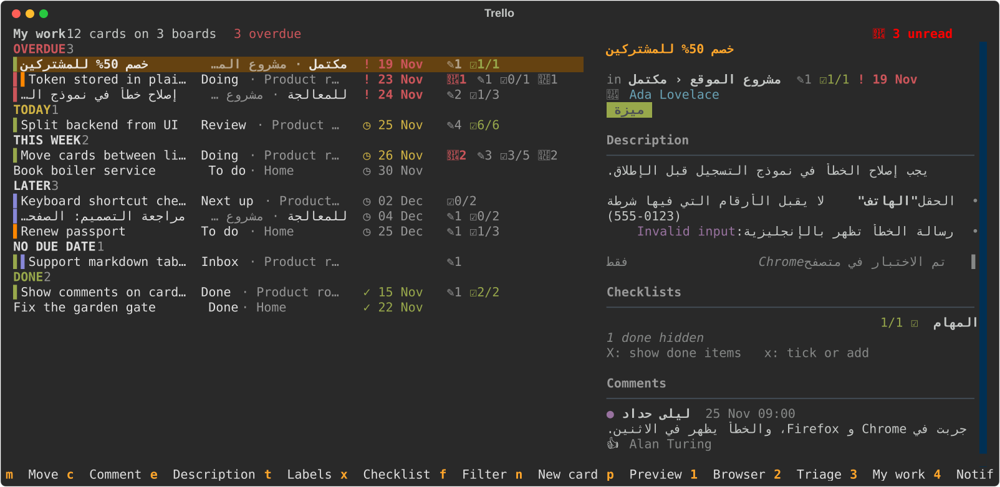

## Searching

`/` searches every board you can see, from any view, and `f` filters the cards already on screen (see Keys). The popup
asks Trello as you type: it waits for a short pause, needs two characters, and matches the start of words, so `passp`
finds "Renew passport". Each result shows the card, "Board › List", and a mark when the card, its list or its board is
archived (🗄). Trello's own search terms work as typed: `board:home`, `label:bug`, `is:open`, `is:archived`.

Enter on an open card goes to it, loading its board if needed. An archived card is not on any board the app loads, so
enter opens its preview; `alt+p` previews any result, and `esc` there comes back to the search as you left it. In
`--demo` the search runs over the demo's cards (its operators are not interpreted).

`A` archives the current card and `D` deletes it for good, from any view with a card; each asks first, and only `y`
confirms. An archived card can be found again with `/`, and trello.com can restore it.

## Drafts

A comment you haven't sent or a description edit you haven't saved is kept as a draft: close the box with `esc`, quit,
or lose the connection, and the text is there the next time you press `c` or `e` on that card. The card's details show
`✐ draft` while it has one. Sending or saving drops the draft; so does emptying the box. A failed send keeps it.

Drafts live in `~/.local/state/tui-trello/drafts.json` (`$XDG_STATE_HOME`), readable only by you, and only
tui-trello sees them: Trello's API has no drafts, so they don't appear on trello.com or in Trello's apps. If someone
changes a description on Trello while you have a draft of it, the editor says so before you save over it.

## Attachments

A card's files and links are listed in its details, and the 📎 badge counts them. `a` opens the list:

- enter opens the highlighted one in your web browser. For a file, trello.com shows or downloads it there, as you
  are logged in.
- `ctrl+s` doesn't save the file: Trello doesn't let apps download uploaded files with the OAuth login, so it reminds
  you to press enter and save it from your web browser.
- `ctrl+y` copies the link.
- "attach a file…" browses for a file to upload: enter goes into a folder or picks a file, typing filters, and
  typing a path (`~/report.pdf`) goes straight to it. Typing or pasting a URL offers to attach it as a link.

Trello has no attachments on comments as such: adding a file while writing a comment uploads it to the card, and the
comment links to it. `ctrl+o` in the comment or description editor does the same, putting the link in at the cursor.

## Replies, reactions and links

Trello comments have no threads, so a reply is a new comment that starts with the one it answers as a quote and
@mentions its author. `C` picks the comment and opens the comment editor with the quote in, ready to type after the
mention; edit or cut the quote as you like. A comment longer than about 280 characters or 6 lines isn't quoted whole:
pick its start, cut at a word, or one of its paragraphs (lines or sentences, in a one-paragraph comment). Quotes in
the comment itself, from an earlier reply, are left out. An unsent comment on the card stays, with the quote after it.
`C` in Notifications replies to the comment a mention or comment notification is about, the same way.

`R` reacts to a comment: pick the comment, then an emoji. Picking one you've already given takes it off. A comment's
reactions show under it, each emoji with who gave it (a count, past three people), yours highlighted.

`E` edits one of your own comments and `d` deletes one: each lists only your comments on the card, `E` opens the
comment editor with its text and saves the change on Trello, `d` asks before deleting. Other people's comments are never
offered, even if you administer the board.

`y` copies the link to the card; `Y` picks a comment and copies the link to it. On a local desktop the link goes
through `wl-copy`, `xclip`, `xsel` or `pbcopy`, whichever is installed. Elsewhere, over SSH for instance, the app asks
the terminal to copy it (OSC 52); most terminals do, but GNOME Terminal and other VTE-based ones don't.

## Following links

Descriptions, comments and checklist items often link to other Trello things. `L` lists every link on the current
card (in the browser, triage, my work or the card screen) in a picker: each has an icon (🗂 board, 🃏 card, 💬 comment,
📎 attachment, 🔗 web page), a label, and a hint saying what it is and where it was found. Typing filters; enter follows
the link, `ctrl+o` opens it in the web browser instead, `ctrl+y` copies it, and `alt+p` previews it (below). A plain
mouse click on a link, or on an `[image: ...]`, does the same as `alt+p`; `ctrl+click` still opens the browser directly
in terminals that support it.

- A card link opens the card, loading its board first if it isn't open. A comment link also scrolls to the comment and
  marks it with a bar down its left side (only the newest 50 comments are loaded; for an older one, `o` opens the card
  on trello.com).
- A board link opens the board in the browser view.
- An attachment link (a pasted screenshot, say) opens the attachments picker on that file: enter opens it.
- Any other `http`, `https` or `mailto` link opens in the web browser. Other schemes are never opened.

`tui-trello --open URL` follows a link at start-up instead of opening the default board: a board link starts on that
board, a card link on the card's board with the card open, a comment link the same, scrolled to the comment, and an
attachment link opens the attachments picker over the default board. It starts in the browser view unless `--layout`
says otherwise. A URL that isn't a Trello board, card, comment or attachment link is refused before the app starts. With
`--demo` it takes the demo's `trello.example` links. Put the URL in single quotes: `#`, `?` and `&` mean things to the
shell. `--open` can't be combined with `--board`, `login`, `logout` or `keys`.

A click on a card, comment or attachment link, or `alt+p` on it in the `L` list, opens a preview in a popup instead of
going there: the whole card (description, attachments, checklists and comments, with a linked comment marked), or the
attachment's name, size and type. The card needn't be on the open board, and nothing is loaded into the browser. `esc`
closes the popup and you are back exactly where you were (from the `L` list, back in the list); `enter` follows the
link, `ctrl+o` opens it in the web browser, `ctrl+y` copies it. A click on a link inside a preview opens a further
preview. Board and web links have no preview: a click or `alt+p` goes to the board or the web page.

## Notifications

The app checks Trello for new notifications every minute while it runs. Each new one pops up in the corner and as a
desktop notification, and the top bar of every view shows how many are unread with a red 🔔. Boards in the picker,
lists and cards show a 🔔 with the number of unread notifications about them. `4` lists them, newest first:
enter opens the card (loading its board if need be) and marks the card's notifications read, `d` marks one read
without opening it, `D` marks them all, `C` replies to a comment. A reaction to one of your comments says which
emoji it was. Read notifications are hidden; `u` shows or hides them, and the app remembers your choice (in
`~/.local/state/tui-trello/prefs.json`).

Desktop notifications go through `notify-send` on a local Linux desktop. Elsewhere, over SSH for instance, the app
asks the terminal to show one (OSC 777 or OSC 9); GNOME Terminal, Ptyxis, foot, iTerm2, WezTerm, Ghostty, kitty and
Windows Terminal do, and other terminals ignore the request. Set `desktop = false` under `[notifications]` to keep
only the in-app pop-ups.

Marking notifications read needs a permission logins from before notifications were added don't have; if the app
says so, run `tui-trello login` again.


## Keys

Vim-style throughout; `?` in the app shows the keys for the view you are in, and `a` there shows them all. Every key
can be changed: see [Changing keys](#changing-keys).

| key                    | does                                                                               |
| ---------------------- | ---------------------------------------------------------------------------------- |
| `j` `k`                | down, up, in every list, table and scrolling pane                                  |
| `h` `l`                | out, in: back to the lists, into a column, open a card, back from a card           |
| `gg` `G`               | first, last                                                                        |
| `ctrl+d` `ctrl+u`      | half a page down, up                                                               |
| `1`-`4`, `gt` `gT`     | switch view                                                                        |
| `/`                    | search every board on Trello, archived cards too; enter opens, `alt+p` previews    |
| `f`                    | filter the cards on screen: `words #label @member list:name !overdue !due`;        |
|                        | `esc` clears                                                                       |
| `:`                    | command palette: jump to any board or card                                         |
| `b`                    | pick a board                                                                       |
| `n`                    | new card on the list (triage, my work: pick the list first); the first line is its |
|                        | name, the lines after it its description                                           |
| `m` `c` `o`            | move, comment (enter sends, alt+enter new line, `@` mentions), open in the browser |
| `e`                    | edit the description (enter new line, ctrl+s saves)                                |
| `t`                    | labels: enter puts one on or takes it off; type a new name to create one           |
| `x`                    | checklist: enter ticks or unticks an item; type new text to add an item or list    |
| `X`                    | show or hide ticked checklist items in the card pane (hidden at first; remembered) |
| `a`                    | attachments: enter opens one in the browser, where you can save a file (`ctrl+s`   |
|                        | reminds you), `ctrl+y` copies its link; attach a file, or paste a URL to attach a  |
|                        | link                                                                               |
| `ctrl+o`               | in a comment or description: attach a file and put its link in                     |
| `C`                    | reply to a comment (on a card or in notifications): a new comment quoting it and   |
|                        | @mentioning its author                                                             |
| `R`                    | react to a comment: pick the comment, then an emoji; picking yours takes it off    |
| `E` `d`                | edit, delete one of your own comments: pick it first; delete asks first            |
| `A` `D`                | archive the card, delete it for good; both ask first (`y` confirms, not enter)     |
| `y` `Y`                | copy the link to the card, to one of its comments                                  |
| `L`                    | follow a link on the card: Trello cards, comments, boards and attachments open     |
|                        | here, the rest in the browser; `alt+p` in the list previews a card, comment or     |
|                        | attachment in a popup (a click on a link does too); `ctrl+o` opens one in the      |
|                        | browser                                                                            |
| `s`                    | triage: cycle sort (list, due date, last activity)                                 |
| `p`                    | my work: toggle the preview                                                        |
| `d` `D` `u`            | notifications: mark read, mark all read, show or hide read ones (remembered)       |
| `r`                    | reload                                                                             |
| `ctrl+j` `ctrl+k`      | down, up in a picker (typing filters it)                                           |
| `q` / `esc`            | quit / back                                                                        |

## Changing keys

Every key binding has an id, such as `card.archive`: a group, a dot and what it does. `[keys]` in
`~/.config/tui-trello/config.toml` maps ids to keys, and a restart picks the change up everywhere: on every view and
popup, in the footer, the `?` help, the tips and the hints in popups.

```toml
[keys]
card.delete = "ctrl+x"            # delete the card with ctrl+x instead of D
list.filter = ["f", "ctrl+f"]     # two keys for the filter
app.down = "j,down,ctrl+n"        # a comma-separated string works too
chord.next_view = "g n"           # a two-key sequence: g, then n
popup.preview = "ctrl+r"          # preview in the links and search popups
```

`tui-trello keys` prints every id with the key it has now, as lines to copy into the file, and checks `[keys]`.

- A key is a character (`"A"`, `"?"`, `"/"`) or a key name (`"enter"`, `"escape"`, `"tab"`, `"space"`, `"up"`,
  `"pagedown"`, `"f5"`, `"comma"` for `,`), with `ctrl+`, `alt+`, `shift+`, `meta+` or `super+` in front if you like
  (`"ctrl+a"`, `"alt+p"`). `shift+a` means `A`, which is what the terminal sends for Shift+A.
- A value is one key, a comma-separated string, or a list. The keys you give replace *all* the id's defaults: after
  `app.down = "n"`, `j` and the down arrow no longer move down.
- Several places can share an id, and an override changes them all: `app.down` is also the scroll key in the link
  preview, and `popup.copy_link` copies a link in the links, attachments and preview popups.
- A chord is exactly two characters, with or without a space (`"g t"`, `"gt"`). Chords only start with a character.
- `[keys]` also takes `card.archive = "A"` written as a `[keys.card]` table with `archive = "A"`, or as
  `"card.archive" = "A"`.
- A mistake never stops the app: an unknown id (it suggests the nearest), a value that is not a key, or a printable
  key (a letter, a digit, a symbol) for a popup with a text box, which would type it, is skipped, and the id keeps its
  default. So is a *clash*: a key another action already has where both work, such as `card.archive = "m"` (Move) or a
  chord's first key. Of two overrides that clash, the later one is skipped. A swap (`card.archive = "D"` with
  `card.delete = "A"`) is not a clash. One toast at start-up lists the problems, and `tui-trello keys` prints them and
  exits with status 1.
- Not changeable: Textual's own keys (`ctrl+q`, `ctrl+c`, `ctrl+p`), the keys inside text boxes and lists (typing,
  arrows, Home and End, enter on a row), the mouse, and the filter's query language. A key can also be valid and never
  arrive, because the terminal does not send it (`ctrl+1`, `super+` keys): try a new key in your terminal.
- A key cannot be switched off, only moved.

Every id, with its default key:

<!-- keys-table -->
| id                            | default                | what it does                                      |
| ----------------------------- | ---------------------- | ------------------------------------------------- |
| `app.browser`                 | `1`                    | Go to the browser view                            |
| `app.triage`                  | `2`                    | Go to the triage view                             |
| `app.mywork`                  | `3`                    | Go to my work                                     |
| `app.notifications`           | `4`                    | Go to notifications                               |
| `app.boards`                  | `b`                    | Pick a board                                      |
| `app.refresh`                 | `r`                    | Reload from Trello                                |
| `app.done_items`              | `X`                    | Show or hide ticked checklist items               |
| `app.down`                    | `j, down`              | Move down (any list, table or pane)               |
| `app.up`                      | `k, up`                | Move up                                           |
| `app.bottom`                  | `G, end`               | Jump to the last row                              |
| `app.top`                     | `home`                 | Jump to the first row                             |
| `app.half_down`               | `ctrl+d, pagedown`     | Half a page down                                  |
| `app.half_up`                 | `ctrl+u, pageup`       | Half a page up                                    |
| `app.commands`                | `:`                    | Command palette                                   |
| `app.help`                    | `?`                    | Show or close the key help                        |
| `app.news`                    | `N`                    | Show or close the news about tui-trello           |
| `app.search`                  | `/`                    | Search every board on Trello                      |
| `app.quit`                    | `q`                    | Quit                                              |
| `chord.top`                   | `g g`                  | Jump to the first row                             |
| `chord.next_view`             | `g t`                  | Go to the next view                               |
| `chord.previous_view`         | `g T`                  | Go to the previous view                           |
| `card.move`                   | `m`                    | Move the card to another list                     |
| `card.comment`                | `c`                    | Write a comment                                   |
| `card.description`            | `e`                    | Edit the description                              |
| `card.labels`                 | `t`                    | Put labels on the card or take them off           |
| `card.checklist`              | `x`                    | Tick checklist items, add items                   |
| `card.attachments`            | `a`                    | Attachments: open, add                            |
| `card.reply`                  | `C`                    | Reply to a comment                                |
| `card.react`                  | `R`                    | React to a comment                                |
| `card.copy_link`              | `y`                    | Copy the card's link                              |
| `card.copy_comment_link`      | `Y`                    | Copy the link to a comment                        |
| `card.open`                   | `o`                    | Open the card in the web browser                  |
| `card.follow_link`            | `L`                    | Follow a link on the card                         |
| `card.archive`                | `A`                    | Archive the card (asks first)                     |
| `card.delete`                 | `D`                    | Delete the card for good (asks first)             |
| `card.edit_comment`           | `E`                    | Edit one of your comments                         |
| `card.delete_comment`         | `d`                    | Delete one of your comments (asks first)          |
| `list.filter`                 | `f`                    | Filter the cards on screen                        |
| `list.clear_filter`           | `esc`                  | Clear the filter                                  |
| `list.new_card`               | `n`                    | Make a new card                                   |
| `list.open`                   | `l, right`             | Open the card                                     |
| `board.copy_link`             | `B`                    | Copy the board's link                             |
| `browser.in`                  | `l, right`             | Into the cards; open a card                       |
| `browser.out`                 | `h, left`              | Back to the lists                                 |
| `triage.sort`                 | `s`                    | Cycle the sort                                    |
| `mywork.preview`              | `p`                    | Show or hide the preview                          |
| `card_screen.back`            | `esc, q, h, left`      | Close the card                                    |
| `notifications.mark_read`     | `d`                    | Mark the notification read                        |
| `notifications.mark_all_read` | `D`                    | Mark every notification read                      |
| `notifications.toggle_read`   | `u`                    | Hide or show the ones you've read                 |
| `help.close`                  | `esc, q`               | Close the key help                                |
| `help.all`                    | `a`                    | Every key, or just this view's                    |
| `news.close`                  | `esc, q`               | Close the news                                    |
| `preview.close`               | `esc, q`               | Close the link preview                            |
| `preview.follow`              | `enter`                | Follow the link                                   |
| `popup.open_in_browser`       | `ctrl+o`               | Open the link in the web browser                  |
| `popup.copy_link`             | `ctrl+y`               | Copy the link                                     |
| `popup.preview`               | `alt+p`                | Preview the highlighted link or result            |
| `picker.close`                | `esc`                  | Close the popup                                   |
| `picker.down`                 | `ctrl+j, down, ctrl+n` | Next row                                          |
| `picker.up`                   | `ctrl+k, up, ctrl+p`   | Previous row                                      |
| `attachments.save`            | `ctrl+s`               | Say how to save the file (open it in the browser) |
| `editor.cancel`               | `esc`                  | Close the editor (a draft is kept)                |
| `editor.enter`                | `enter`                | Send (a new line in a description)                |
| `editor.save`                 | `ctrl+s`               | Save                                              |
| `editor.mention`              | `tab`                  | Pick the @mention                                 |
| `editor.mention_down`         | `down`                 | Next @mention                                     |
| `editor.mention_up`           | `up`                   | Previous @mention                                 |
| `editor.newline`              | `alt+enter, ctrl+j`    | Start a new line                                  |
| `editor.attach`               | `ctrl+o`               | Attach a file                                     |
| `confirm.yes`                 | `y`                    | Confirm                                           |
| `confirm.no`                  | `n, esc`               | Cancel                                            |
<!-- /keys-table -->

## News

tui-trello shows news about itself, such as a new release or a change to how you log in. A short check in the
background, at most once an hour, reads `remote/newsfeed.md` from this repository's `main` branch on GitHub. When there
is news you haven't seen, a toast says so and `✦ 1 news (N)` appears in the top bar; `N` opens the news, and marks it
seen. `N` again, `esc` or `q` closes it. The news is plain text: its links are not clickable.

To turn it off, put `enabled = false` under `[remote]` in `config.toml`, or start with `tui-trello --no-remote`. The
app then makes no request to GitHub and ignores any copy it saved. See [docs/remote.md](docs/remote.md) for the
format, and what the file can and can't change.

## Development

See [CONTRIBUTING.md](CONTRIBUTING.md) for setting up, running, testing and the commit style, and
[docs/architecture.md](docs/architecture.md) for how the code is laid out and how to add a feature.
[docs/tui-designs.md](docs/tui-designs.md) has the interface designs, built and proposed.

```sh
python -m venv venv && venv/bin/pip install -e '.[dev]'
venv/bin/python -m tui_trello --demo
venv/bin/pytest                     # unit tests and keyboard-driven UI tests, no network
venv/bin/ruff check .
```

With Textual's dev tools, use two terminals:

```sh
textual console                                 # terminal 1: shows self.log(...), print() and errors
textual run --dev -c tui-trello --demo          # terminal 2: the app, connected to the console
```

The app takes over the terminal, so `print()` output and tracebacks from workers only show up in the console. Quit
with `q` and start again to pick up code changes.

## Screenshots

All generated from the demo data (`python scripts/screenshots.py`).

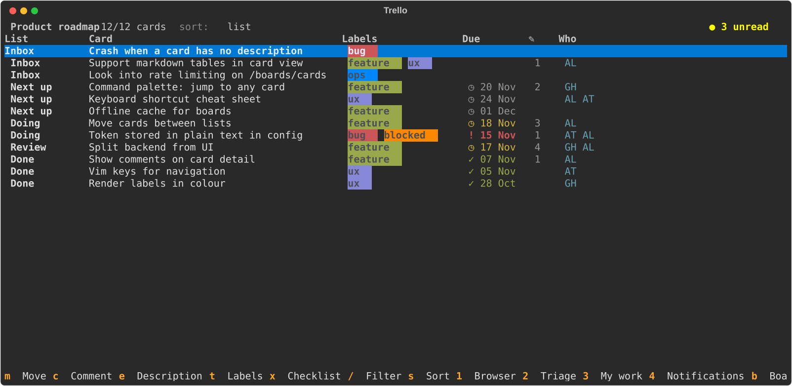

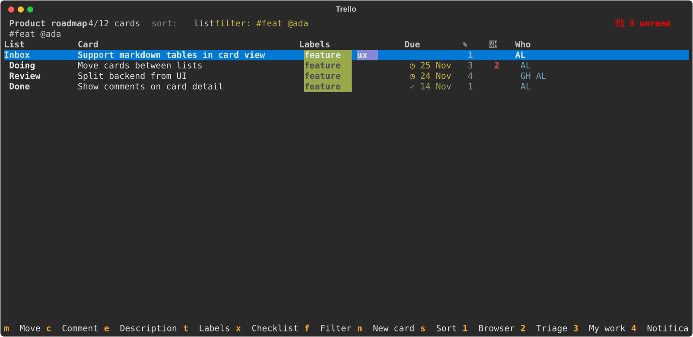

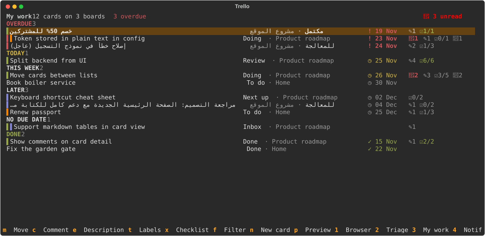

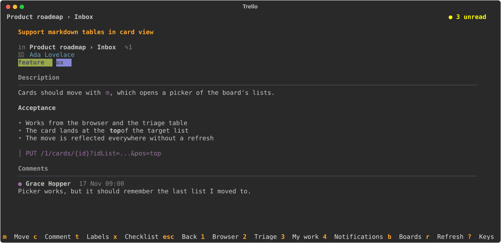

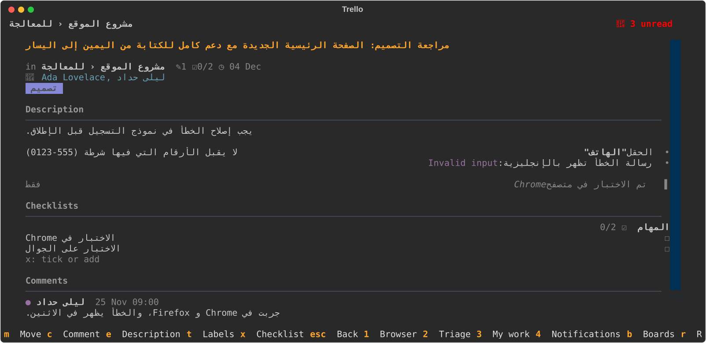


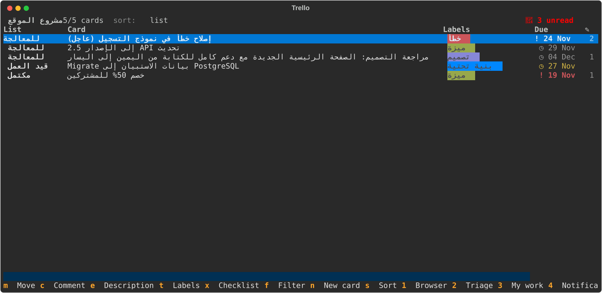

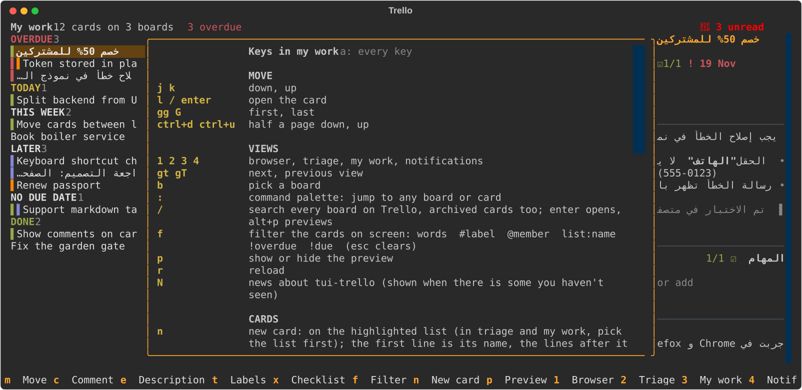

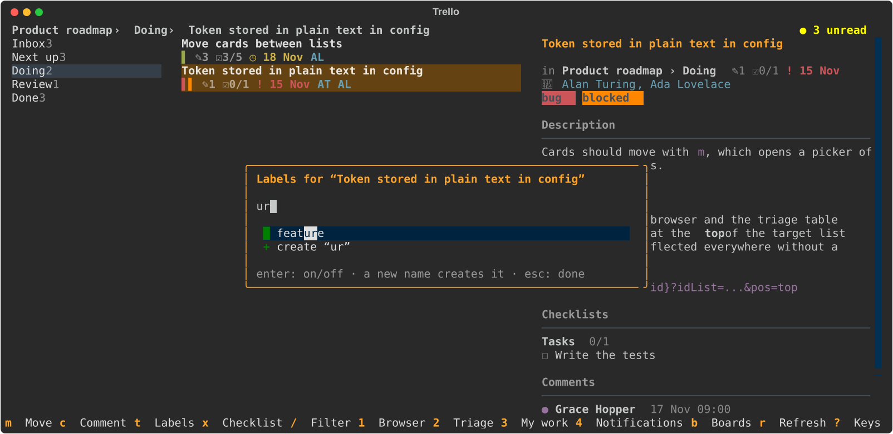

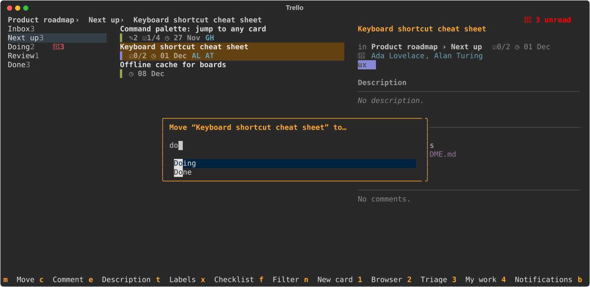

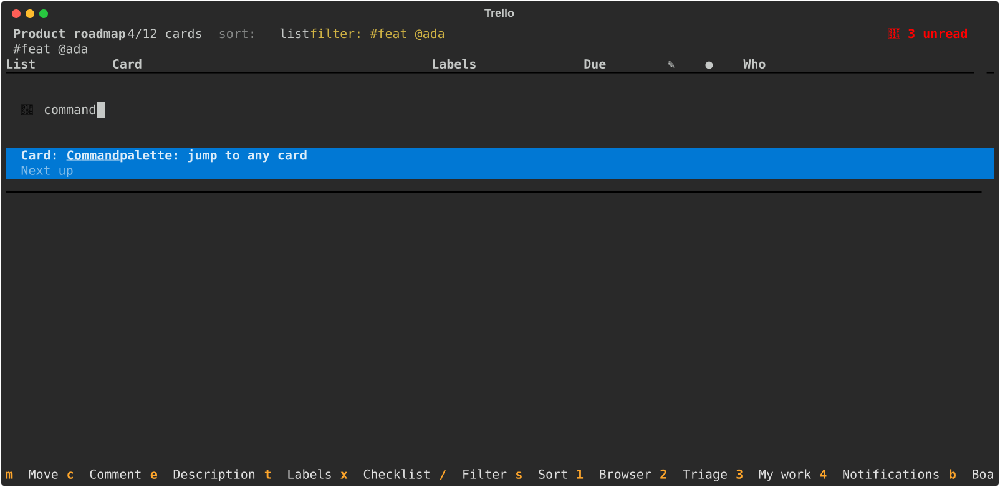

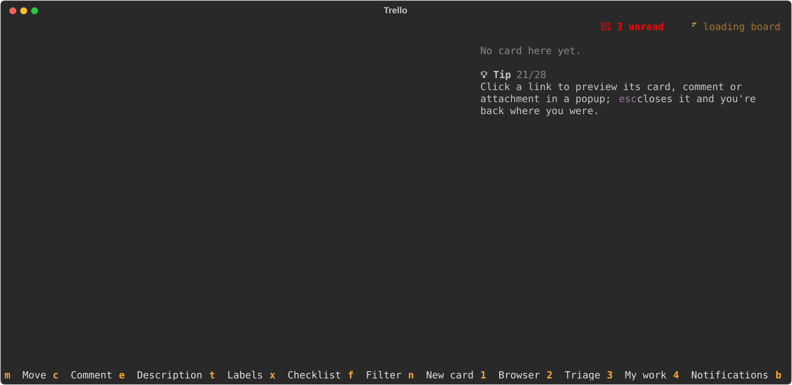

## Privacy

tui-trello talks to Trello and, unless you turn it off (see News), fetches one public file from
`raw.githubusercontent.com`: a plain GET with no identifiers, no version and no cookies, so GitHub sees your IP address
as it would for any web request. It stores your login, drafts, preferences and a copy of that file on your
machine, readable only by you. It sends no telemetry.

## Contributing

Bug reports, ideas and pull requests are welcome: read [CONTRIBUTING.md](CONTRIBUTING.md) first, and please follow the
[code of conduct](CODE_OF_CONDUCT.md). Changes are listed in [CHANGELOG.md](CHANGELOG.md).

## Security

To report a vulnerability, use GitHub's private vulnerability reporting (the Security tab of the repository), not a
public issue. See [SECURITY.md](SECURITY.md) for what the app stores and what it fetches.

## License

[MIT](LICENSE) (c) 2026 Phil Nicholls.
