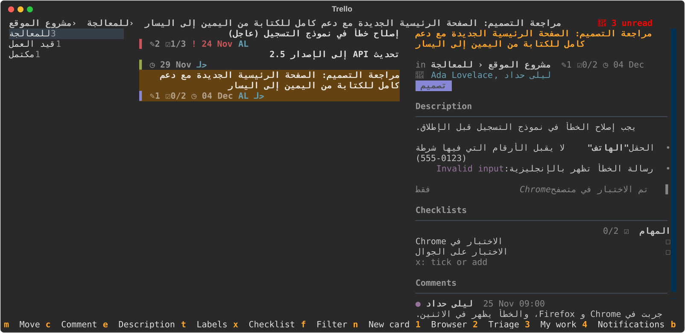

# tui-trello

A keyboard-first terminal client for Trello, built on [Textual](https://textual.textualize.io/).


## Install and run

```sh
python -m venv venv && venv/bin/pip install -e '.[dev]'
venv/bin/tui-trello --demo          # sample data, no Trello account needed
venv/bin/tui-trello                 # your boards
venv/bin/tui-trello --board tK1afjyM --layout triage
venv/bin/tui-trello --open 'https://trello.com/c/nVTbsQMq'   # a board, card, comment or attachment link
```

### Logging in

```sh
venv/bin/tui-trello login
```

Trello (Atlassian) opens in your browser and asks whether to let tui-trello use your account. Click **Accept** and
you're done: the browser hands the login back to the app on `http://127.0.0.1:8765`, and the app saves it to
`~/.config/tui-trello/credentials.json` (readable only by you). This is OAuth 2.0 with PKCE; you don't need an API
key, secret or token of your own. The app renews the login by itself; you only log in again if you don't use it for
90 days or revoke it. Running `tui-trello` without logging in starts the same flow, and `tui-trello logout` forgets
it (revoke it under Applications at https://trello.com/my/account).

`tui-trello login --token` is Trello's older flow, as a fallback: Trello shows a token for the app's API key, which
you paste into the terminal.

For the maintainers: the OAuth client (`OAUTH_CLIENT_ID` in `src/tui_trello/auth.py`) is set up at
https://trello.com/apps/admin with callback URL `http://127.0.0.1:8765/callback` and the scopes in `auth.SCOPES`.

Optional settings go in `~/.config/tui-trello/config.toml`:

```toml
[trello]
default_board = "tK1afjyM"   # open this board at start-up instead of choosing one

[ui]
layout = "browser"           # browser, triage, mywork or notifications
transparent = true           # use the terminal's own background and colours (the default)

[notifications]
interval = 60                # check for new Trello notifications every minute; 0 turns it off
desktop = true               # also raise a desktop notification for each new one
```

`TRELLO_API_KEY` and `TRELLO_TOKEN` in the environment are only for the older token flow; leave them unset.
A token set in `TRELLO_TOKEN` (or `token` under `[trello]` in the config) is used instead of your saved login.

## Right-to-left text

Arabic and other right-to-left scripts in card names, lists, labels, descriptions and comments are laid out by the app: each field is
wrapped or cut in reading order, then reordered for display, and RTL paragraphs are right-aligned. Terminals that
reorder RTL text themselves (GNOME Terminal, Ptyxis, Tilix and other VTE-based ones) are told not to while the app
runs, since they reorder whole screen lines, across panes. Other terminals need no setting. The demo has an Arabic
board (`b`, then "مشروع").

Descriptions and comments show their Markdown styled: bold, italic, strikethrough, `code`, links, @mentions, headings,
lists, quotes, code blocks and tables, in either direction. Checklist items get the inline part: bold, italic,
strikethrough, `code`, links and @mentions. Ticked checklist items are hidden, with a count of them under each
checklist; `X` shows them, and the app remembers the choice.



## Views

| key | view          | for                                                                             |
| --- | ------------- | ------------------------------------------------------------------------------- |
| `1` | browser       | one board as columns: lists, cards, preview                                     |
| `2` | triage        | every card on the board as a sortable, filterable table                         |
| `3` | my work       | your cards on every board, grouped by due date (overdue, today, this week, ...) |
| `4` | notifications | Trello's notifications (the bell): mentions, cards you were added to, comments, |
|     |               | due dates                                                                       |


## Drafts

A comment you haven't sent or a description edit you haven't saved is kept as a draft: close the box with `esc`, quit,
or lose the connection, and the text is there the next time you press `c` or `e` on that card. The card's details show
`✐ draft` while it has one. Sending or saving drops the draft; so does emptying the box. A failed send keeps it.

Drafts live in `~/.local/state/tui-trello/drafts.json` (`$XDG_STATE_HOME`), readable only by you, and only
tui-trello sees them: Trello's API has no drafts, so they don't appear on trello.com or in Trello's apps. If someone
changes a description on Trello while you have a draft of it, the editor says so before you save over it.

## Attachments

A card's files and links are listed in its details, and the 📎 badge counts them. `a` opens the list:

- enter opens the highlighted one in your web browser. For a file, trello.com shows or downloads it there, as you
  are logged in.
- `ctrl+s` saves a file to your downloads folder (`$XDG_DOWNLOAD_DIR`, else `~/Downloads`), adding ` (1)` to the
  name if it's taken. Trello only lets the app download files if you logged in with `tui-trello login --token`; with
  the browser login (no OAuth 2.0 permission covers downloads) use enter instead.
- `ctrl+y` copies the link.
- "attach a file…" browses for a file to upload: enter goes into a folder or picks a file, typing filters, and
  typing a path (`~/report.pdf`) goes straight to it. Typing or pasting a URL offers to attach it as a link.

Trello has no attachments on comments as such: adding a file while writing a comment uploads it to the card, and the
comment links to it. `ctrl+o` in the comment or description editor does the same, putting the link in at the cursor.

## Replies, reactions and links

Trello comments have no threads, so a reply is a new comment that starts with the one it answers as a quote and
@mentions its author. `C` picks the comment and opens the comment editor with the quote in, ready to type after the
mention; edit or cut the quote as you like. A comment longer than about 280 characters or 6 lines isn't quoted whole:
pick its start, cut at a word, or one of its paragraphs (lines or sentences, in a one-paragraph comment). Quotes in
the comment itself, from an earlier reply, are left out. An unsent comment on the card stays, with the quote after it.
`C` in Notifications replies to the comment a mention or comment notification is about, the same way.

`R` reacts to a comment: pick the comment, then an emoji. Picking one you've already given takes it off. A comment's
reactions show under it, each emoji with who gave it (a count, past three people), yours highlighted.

`y` copies the link to the card; `Y` picks a comment and copies the link to it. On a local desktop the link goes
through `wl-copy`, `xclip`, `xsel` or `pbcopy`, whichever is installed. Elsewhere, over SSH for instance, the app asks
the terminal to copy it (OSC 52); most terminals do, but GNOME Terminal and other VTE-based ones don't.

## Following links

Descriptions, comments and checklist items often link to other Trello things. `L` lists every link on the current
card (in the browser, triage, my work or the card screen) in a picker: each has an icon (🗂 board, 🃏 card, 💬 comment,
📎 attachment, 🔗 web page), a label, and a hint saying what it is and where it was found. Typing filters; enter follows
the link, `ctrl+o` opens it in the web browser instead, `ctrl+y` copies it, and `alt+p` previews it (below). A plain
mouse click on a link, or on an `[image: ...]`, does the same as `alt+p`; `ctrl+click` still opens the browser directly
in terminals that support it.

- A card link opens the card, loading its board first if it isn't open. A comment link also scrolls to the comment and
  marks it with a bar down its left side (only the newest 50 comments are loaded; for an older one, `o` opens the card
  on trello.com).
- A board link opens the board in the browser view.
- An attachment link (a pasted screenshot, say) opens the attachments picker on that file: enter opens it, `ctrl+s`
  saves it.
- Any other `http`, `https` or `mailto` link opens in the web browser. Other schemes are never opened.

`tui-trello --open URL` follows a link at start-up instead of opening the default board: a board link starts on that
board, a card link on the card's board with the card open, a comment link the same, scrolled to the comment, and an
attachment link opens the attachments picker over the default board. It starts in the browser view unless `--layout`
says otherwise. A URL that isn't a Trello board, card, comment or attachment link is refused before the app starts. With
`--demo` it takes the demo's `trello.example` links. Put the URL in single quotes: `#`, `?` and `&` mean things to the
shell. `--open` can't be combined with `--board`, `login` or `logout`.

A click on a card, comment or attachment link, or `alt+p` on it in the `L` list, opens a preview in a popup instead of
going there: the whole card (description, attachments, checklists and comments, with a linked comment marked), or the
attachment's name, size and type. The card needn't be on the open board, and nothing is loaded into the browser. `esc`
closes the popup and you are back exactly where you were (from the `L` list, back in the list); `enter` follows the
link, `ctrl+o` opens it in the web browser, `ctrl+y` copies it. A click on a link inside a preview opens a further
preview. Board and web links have no preview: a click or `alt+p` goes to the board or the web page.

## Notifications

The app checks Trello for new notifications every minute while it runs. Each new one pops up in the corner and as a
desktop notification, and the top bar of every view shows how many are unread with a red 🔔. Boards in the picker,
lists and cards show a 🔔 with the number of unread notifications about them. `4` lists them, newest first:
enter opens the card (loading its board if need be) and marks the card's notifications read, `d` marks one read
without opening it, `D` marks them all, `C` replies to a comment. A reaction to one of your comments says which
emoji it was. Read notifications are hidden; `u` shows or hides them, and the app remembers your choice (in
`~/.local/state/tui-trello/prefs.json`).

Desktop notifications go through `notify-send` on a local Linux desktop. Elsewhere, over SSH for instance, the app
asks the terminal to show one (OSC 777 or OSC 9); GNOME Terminal, Ptyxis, foot, iTerm2, WezTerm, Ghostty, kitty and
Windows Terminal do, and other terminals ignore the request. Set `desktop = false` under `[notifications]` to keep
only the in-app pop-ups.

Marking notifications read needs a permission logins from before notifications were added don't have; if the app
says so, run `tui-trello login` again.


## Keys

Vim-style throughout; `?` in the app shows the keys for the view you are in, and `a` there shows them all.

| key                    | does                                                                               |
| ---------------------- | ---------------------------------------------------------------------------------- |
| `j` `k`                | down, up, in every list, table and scrolling pane                                  |
| `h` `l`                | out, in: back to the lists, into a column, open a card, back from a card           |
| `gg` `G`               | first, last                                                                        |
| `ctrl+d` `ctrl+u`      | half a page down, up                                                               |
| `1`-`4`, `gt` `gT`     | switch view                                                                        |
| `/`                    | filter: `words #label @member list:name !overdue !due`; `esc` clears               |
| `:`                    | command palette: jump to any board or card                                         |
| `b`                    | pick a board                                                                       |
| `n`                    | new card on the list (triage, my work: pick the list first); the first line is its |
|                        | name, the lines after it its description                                           |
| `m` `c` `o`            | move, comment (enter sends, alt+enter new line, `@` mentions), open in the browser |
| `e`                    | edit the description (enter new line, ctrl+s saves)                                |
| `t`                    | labels: enter puts one on or takes it off; type a new name to create one           |
| `x`                    | checklist: enter ticks or unticks an item; type new text to add an item or list    |
| `X`                    | show or hide ticked checklist items in the card pane (hidden at first; remembered) |
| `a`                    | attachments: enter opens one in the browser, `ctrl+s` saves it to Downloads,       |
|                        | `ctrl+y` copies its link; attach a file, or paste a URL to attach a link           |
| `ctrl+o`               | in a comment or description: attach a file and put its link in                     |
| `C`                    | reply to a comment (on a card or in notifications): a new comment quoting it and   |
|                        | @mentioning its author                                                             |
| `R`                    | react to a comment: pick the comment, then an emoji; picking yours takes it off    |
| `y` `Y`                | copy the link to the card, to one of its comments                                  |
| `L`                    | follow a link on the card: Trello cards, comments, boards and attachments open     |
|                        | here, the rest in the browser; `alt+p` in the list previews a card, comment or     |
|                        | attachment in a popup (a click on a link does too); `ctrl+o` opens one in the      |
|                        | browser                                                                            |
| `s`                    | triage: cycle sort (list, due date, last activity)                                 |
| `p`                    | my work: toggle the preview                                                        |
| `d` `D` `u`            | notifications: mark read, mark all read, show or hide read ones (remembered)       |
| `r`                    | reload                                                                             |
| `ctrl+j` `ctrl+k`      | down, up in a picker (typing filters it)                                           |
| `q` / `esc`            | quit / back                                                                        |

## Development

Run from source (the package is installed editable, so code changes apply on the next start):

```sh
source venv/bin/activate
python -m tui_trello --demo         # or: tui-trello --demo / tui-trello login / tui-trello
```

With Textual's dev tools, use two terminals:

```sh
textual console                                 # terminal 1: shows self.log(...), print() and errors
textual run --dev -c tui-trello --demo          # terminal 2: the app, connected to the console
```

The app takes over the terminal, so `print()` output and tracebacks from workers only show up in the console. Quit
with `q` and start again to pick up code changes.

```sh
venv/bin/pytest                     # unit tests and keyboard-driven UI tests, no network
venv/bin/python scripts/screenshots.py   # regenerate docs/screenshots from the demo data
```

See [docs/architecture.md](docs/architecture.md) for how the code is laid out and how to add a feature, and
[docs/tui-designs.md](docs/tui-designs.md) for the interface designs, built and proposed.
