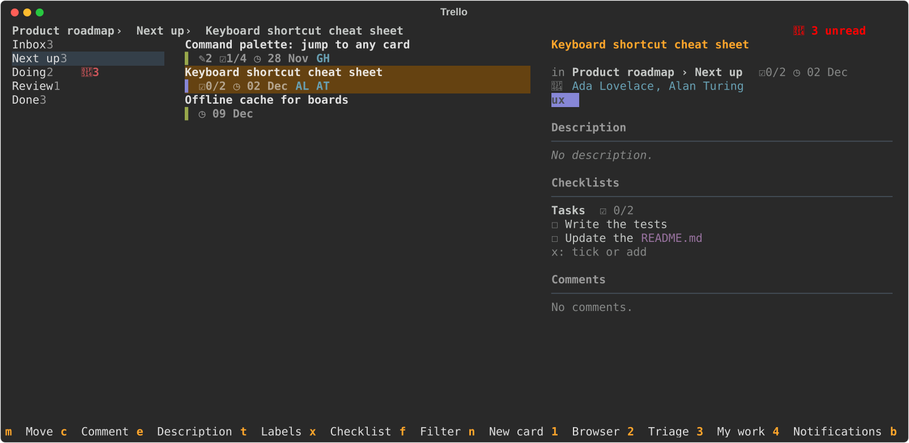
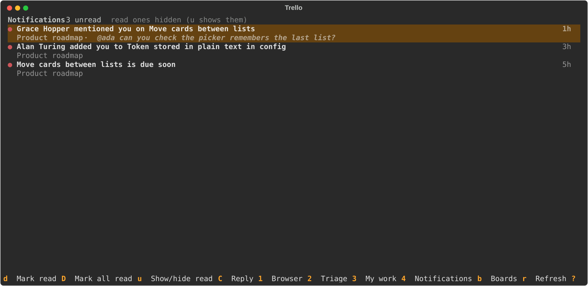

# tui-trello

A keyboard-first terminal client for Trello, built on [Textual](https://textual.textualize.io/).



## Install and run

```sh
python -m venv venv && venv/bin/pip install -e '.[dev]'
venv/bin/tui-trello --demo          # sample data, no Trello account needed
venv/bin/tui-trello                 # your boards
venv/bin/tui-trello --board tK1afjyM --layout triage
```

### Logging in

```sh
venv/bin/tui-trello login
```

Trello (Atlassian) opens in your browser and asks whether to let tui-trello use your account. Click **Accept** and
you're done: the browser hands the login back to the app on `http://127.0.0.1:8765`, and the app saves it to
`~/.config/tui-trello/credentials.json` (readable only by you). This is OAuth 2.0 with PKCE; you don't need an API
key, secret or token of your own. The app renews the login by itself; you only log in again if you don't use it for
90 days or revoke it. Running `tui-trello` without logging in starts the same flow, and `tui-trello logout` forgets
it (revoke it under Applications at https://trello.com/my/account).

`tui-trello login --token` is Trello's older flow, as a fallback: Trello shows a token for the app's API key, which
you paste into the terminal.

For the maintainers: the OAuth client (`OAUTH_CLIENT_ID` in `src/tui_trello/auth.py`) is set up at
https://trello.com/apps/admin with callback URL `http://127.0.0.1:8765/callback` and the scopes in `auth.SCOPES`.

Optional settings go in `~/.config/tui-trello/config.toml`:

```toml
[trello]
default_board = "tK1afjyM"   # open this board at start-up instead of choosing one

[ui]
layout = "browser"           # browser, triage, mywork or notifications
transparent = true           # use the terminal's own background and colours (the default)

[notifications]
interval = 60                # check for new Trello notifications every minute; 0 turns it off
desktop = true               # also raise a desktop notification for each new one
```

`TRELLO_API_KEY` and `TRELLO_TOKEN` in the environment are only for the older token flow; leave them unset.
A token set in `TRELLO_TOKEN` (or `token` under `[trello]` in the config) is used instead of your saved login.

## Right-to-left text

Arabic and other right-to-left scripts in card names, lists, labels, descriptions and comments are laid out by the app: each field is
wrapped or cut in reading order, then reordered for display, and RTL paragraphs are right-aligned. Terminals that
reorder RTL text themselves (GNOME Terminal, Ptyxis, Tilix and other VTE-based ones) are told not to while the app
runs, since they reorder whole screen lines, across panes. Other terminals need no setting. The demo has an Arabic
board (`b`, then "مشروع").

Descriptions and comments show their Markdown styled: bold, italic, strikethrough, `code`, links, @mentions, headings,
lists, quotes, code blocks and tables, in either direction.


## Views

| key | view          | for                                                                             |
| --- | ------------- | ------------------------------------------------------------------------------- |
| `1` | browser       | one board as columns: lists, cards, preview                                     |
| `2` | triage        | every card on the board as a sortable, filterable table                         |
| `3` | my work       | your cards on every board, grouped by due date (overdue, today, this week, ...) |
| `4` | notifications | Trello's notifications (the bell): mentions, cards you were added to, comments, |
|     |               | due dates                                                                       |


## Notifications

The app checks Trello for new notifications every minute while it runs. Each new one pops up in the corner and as a
desktop notification, and the top bar of every view shows how many are unread. `4` lists them, newest first: enter
opens the card (loading its board if need be) and marks the card's notifications read, `d` marks one read without
opening it, `D` marks them all, `u` shows only the unread ones.

Desktop notifications go through `notify-send` on a local Linux desktop. Elsewhere, over SSH for instance, the app
asks the terminal to show one (OSC 777 or OSC 9); GNOME Terminal, Ptyxis, foot, iTerm2, WezTerm, Ghostty, kitty and
Windows Terminal do, and other terminals ignore the request. Set `desktop = false` under `[notifications]` to keep
only the in-app pop-ups.

Marking notifications read needs a permission logins from before notifications were added don't have; if the app
says so, run `tui-trello login` again.



## Keys

Vim-style throughout; `?` shows them all in the app.

| key                    | does                                                                               |
| ---------------------- | ---------------------------------------------------------------------------------- |
| `j` `k`                | down, up, in every list, table and scrolling pane                                  |
| `h` `l`                | out, in: back to the lists, into a column, open a card, back from a card           |
| `gg` `G`               | first, last                                                                        |
| `ctrl+d` `ctrl+u`      | half a page down, up                                                               |
| `1`-`4`, `gt` `gT`     | switch view                                                                        |
| `/`                    | filter: `words #label @member list:name !overdue !due`; `esc` clears               |
| `:`                    | command palette: jump to any board or card                                         |
| `b`                    | pick a board                                                                       |
| `m` `c` `o`            | move, comment (enter sends, alt+enter new line, `@` mentions), open in the browser |
| `t`                    | labels: enter puts one on or takes it off; type a new name to create one           |
| `x`                    | checklist: enter ticks or unticks an item; type new text to add an item or list    |
| `s`                    | triage: cycle sort (list, due date, last activity)                                 |
| `p`                    | my work: toggle the preview                                                        |
| `d` `D` `u`            | notifications: mark read, mark all read, unread only                               |
| `r`                    | reload                                                                             |
| `ctrl+j` `ctrl+k`      | down, up in a picker (typing filters it)                                           |
| `q` / `esc`            | quit / back                                                                        |

## Development

Run from source (the package is installed editable, so code changes apply on the next start):

```sh
source venv/bin/activate
python -m tui_trello --demo         # or: tui-trello --demo / tui-trello login / tui-trello
```

With Textual's dev tools, use two terminals:

```sh
textual console                                 # terminal 1: shows self.log(...), print() and errors
textual run --dev -c tui-trello --demo          # terminal 2: the app, connected to the console
```

The app takes over the terminal, so `print()` output and tracebacks from workers only show up in the console. Quit
with `q` and start again to pick up code changes.

```sh
venv/bin/pytest                     # unit tests and keyboard-driven UI tests, no network
venv/bin/python scripts/screenshots.py   # regenerate docs/screenshots from the demo data
```

See [docs/architecture.md](docs/architecture.md) for how the code is laid out and how to add a feature, and
[docs/tui-designs.md](docs/tui-designs.md) for the interface designs, built and proposed.
