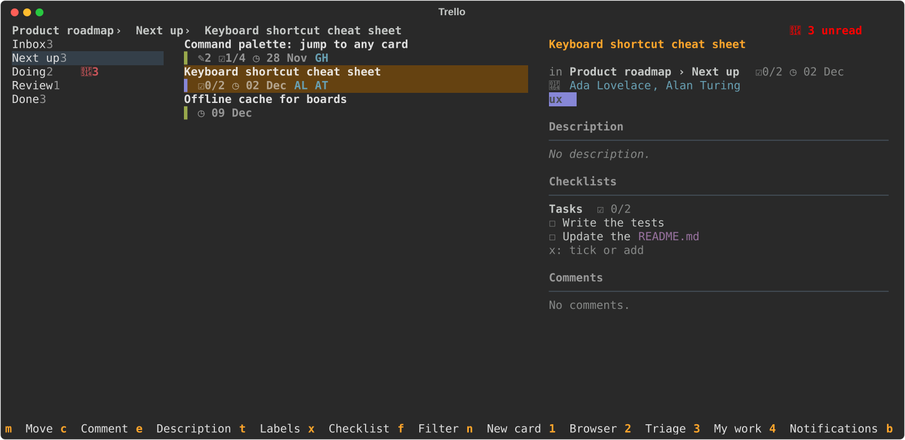
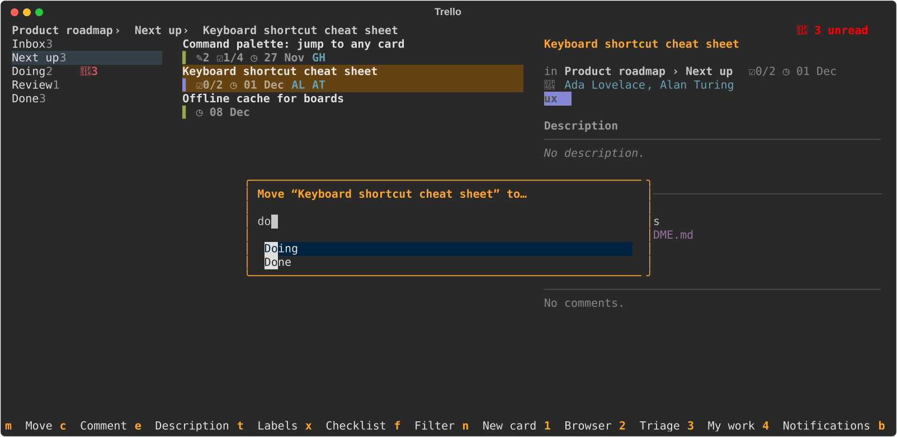
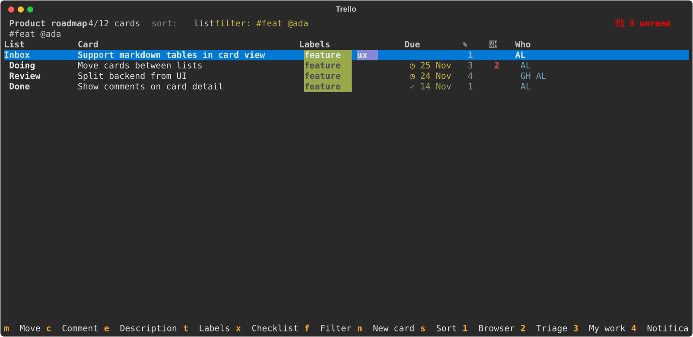
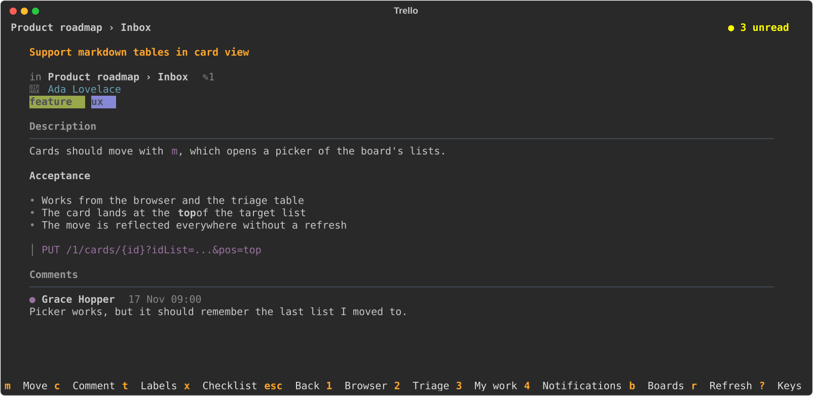
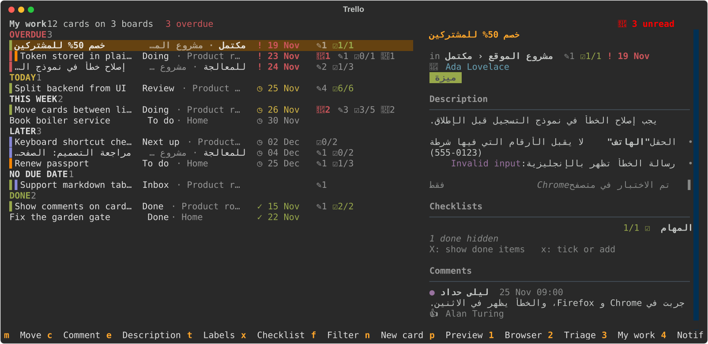
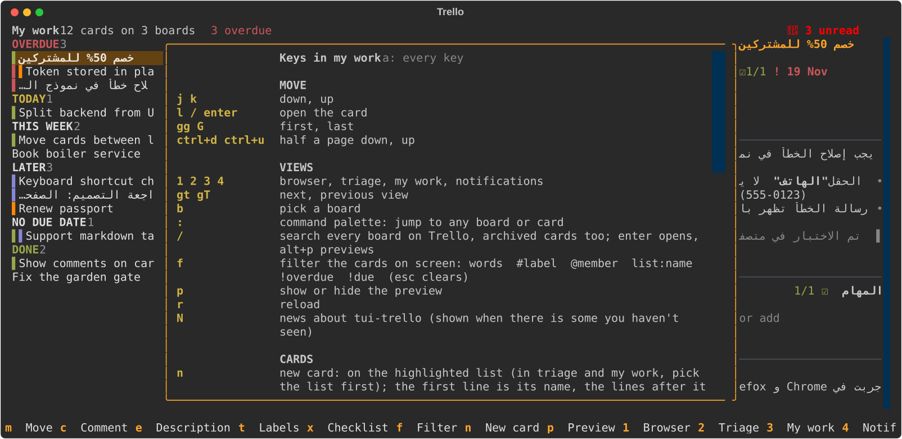

# Interface designs

The proof of concept copied the web app: a column of card "tiles", a full-page detail view with a Back button. That
is the weakest shape for a terminal. A Kanban board needs width (five lists at 30 columns each is 150 characters
before any padding), tiles waste rows on borders, and drag and drop has no keyboard equivalent. Terminals are good at
the opposite things: dense rows, instant filtering, a cursor that is always somewhere, and one-key verbs.

So the designs below follow a few rules:

- **One line (or two) per card**, with metadata as compact glyphs: `▌` label colours, `✎3` comments, `☑1/4`
  checklist, `◷ 19 Nov` / `! 14 Nov` due dates, `AL` member initials.
- **Verbs, not drag and drop**: `m` move (fuzzy pick the list), `c` comment, `o` open in browser. A verb works the
  same in every view.
- **Filter everything** with one small language: `login #bug @ada list:doing !overdue`.
- **Jump, don't navigate**: `ctrl+p` finds any board or card by name.
- **Preview beside, not instead of**: the selected card is visible without leaving the list.

Three designs are built (A, B and C; `1` `2` `3` or `gt` `gT` switch between them). D to F are proposals.

Every view uses the same vim-style keys: `j` `k` `gg` `G` `ctrl+d` `ctrl+u` to move, `h` to back out and `l` to go
in, `/` to filter, `:` for the command palette, `?` for the key reference.

## A. Browser (built, default)

Miller columns, as in ranger, lf or macOS Finder: lists │ cards │ preview. `h`/`l` move between columns, `j`/`k`
within one, and the preview follows the cursor, comments included. It shows one list at a time, so it fits an
80-column terminal, and it is the closest to the board's own structure.





## B. Triage table (built)

Every open card on the board as a row, like `tig`, `htop` or a mail client's index. Sort with `s` (list order, due
date, last activity), filter with `/`. This is the view for "what is overdue?", "what is Ada working on?", "what
has `#bug` and nobody assigned?": questions the web board answers badly because you have to scan every column.





## C. My work (built)

The cards assigned to you, across every board, grouped by when they're due, like taskwarrior or an email "today"
view. For most people this is the screen to open first: it answers "what should I do now?" without choosing a
board. `p` hides the preview for a full-width list; `m`, `c` and `/` work as everywhere else, and a move here
updates the board views too. Data: `/members/me`, `/members/me/cards` and `/members/me/boards` (with lists),
fetched together.





Verbs it suggests next: `d` to set a due date (`+2d`, `fri`, `2026-12-01`) and `x` to mark it complete.

## D. Compact board (proposed)

For when you do want the Kanban picture. Lists side by side, but each card is one line, the focused list is wide
and the others shrink to a narrow strip showing card counts and label dots. `h`/`l` slide the focus; the board
never needs horizontal scrolling. `H`/`L` move the selected card to the neighbouring list, the keyboard version of
drag and drop.

```
 Product roadmap                                                               12 cards · 2 overdue
 ┌ Inbox 3 ┐┌ Next up 3 ┐┌─ Doing 2 ───────────────────────────────────────┐┌ Review 1 ┐┌ Done 3 ┐
 │ ▌ Crash ││ ▌ Command ││ ▌ Move cards between lists       ☑3/5 ◷ Tue  AL ││ ▌ Split  ││ ▌ Show │
 │ ▌▌ Supp ││ ▌ Keyboar ││▶▌▌ Token stored in plain text    ☑0/1 ! 14 N AT ││          ││ ▌ Vim  │
 │ ▌ Look  ││ ▌ Offline ││                                                 ││          ││ ▌ Rend │
 │         ││           ││                                                 ││          ││        │
 └─────────┘└───────────┘└─────────────────────────────────────────────────┘└──────────┘└────────┘
 H/L move card left/right   h/l focus list   enter open   n new card   m move to…
```

## E. Activity log (proposed)

A `tig`-style log of what changed on the board: moves, comments, new cards, newest first, with the card preview
underneath. Good for catching up after a few days away, and Trello's web UI hides it in a side panel. Data:
`GET /boards/{id}/actions`.

```
 Product roadmap · activity                                                   since: 3 days ago
 ─────────────────────────────────────────────────────────────────────────────────────────────
 09:12  GH  moved      Split backend from UI               Doing → Review
 08:40  AL  commented  Move cards between lists            "Pushed a first version, please…"
 Fri    AT  added      Look into rate limiting              to Inbox
 Fri    AL  checked    Command palette: jump to any card   1/4 · "fuzzy matcher"
 Thu    GH  due date   Command palette: jump to any card   → 19 Nov
 ─────────────────────────────────────────────────────────────────────────────────────────────
 Split backend from UI                                          Review  ✎4 ☑6/6  GH
 Grace Hopper: Looks good to me.
```

## F. Quick capture and scripting (proposed)

Not everything needs the full-screen app. Subcommands on the same backend and models:

```sh
tui-trello add "Investigate slow board load" --list Inbox --label bug
tui-trello ls --board product '!overdue @me'          # same filter language, plain-text output
tui-trello mv <card-url> Done
```

`ls` output piped to `fzf`, `grep` or a status bar is where a terminal client earns its keep over the web app.

## Recommendation

With A, B and C built, the next most useful work is verbs rather than views: due dates (`d`, `x`), assigning
(`a`), labels (`t`) and creating cards (`n`), each written once in `CardActionsScreen` so it works in every view.
Consider making **C** the default layout (`[ui] layout = "mywork"`). **D** is worth it only if people miss the
board picture; **E** and **F** reuse the cross-board plumbing C added.
